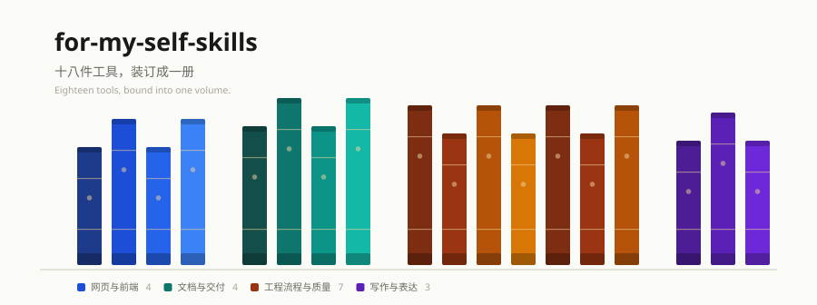
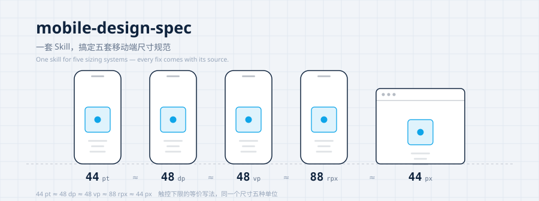
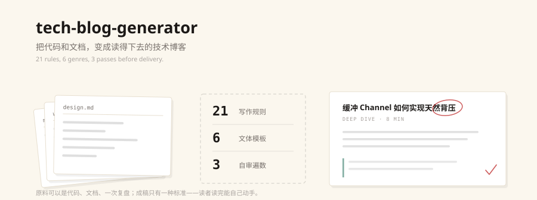
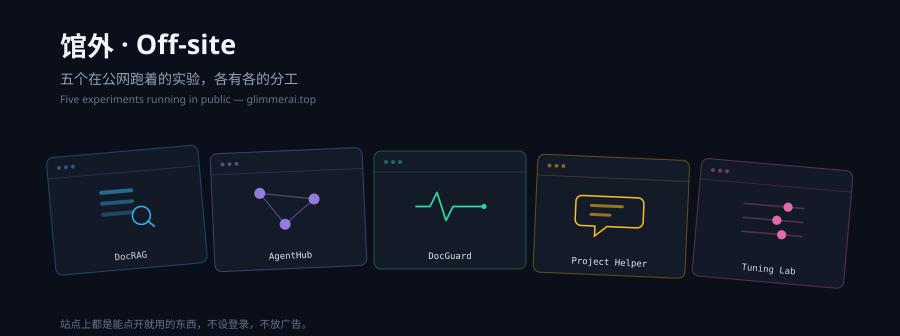
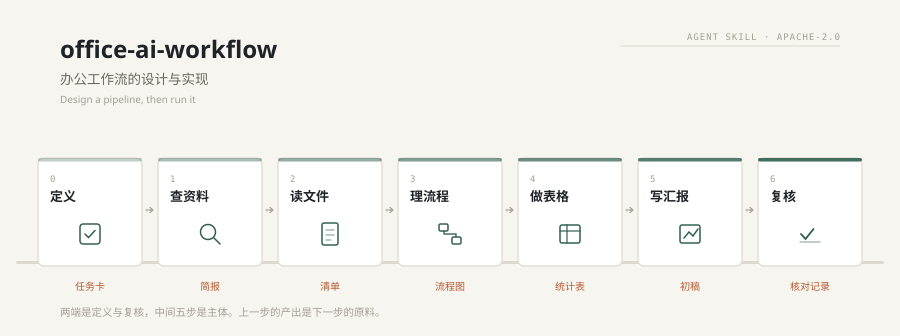
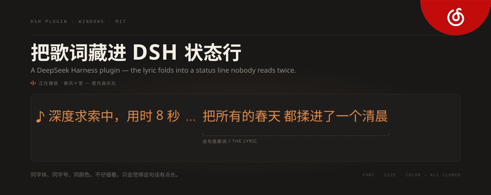

<picture>
  <source media="(prefers-color-scheme: dark)" srcset="./assets/hero-dark.svg">
  <source media="(prefers-color-scheme: light)" srcset="./assets/hero-light.svg">
  
</picture>

[展览说明 Note](#展览说明--note-on-the-collection) · [展品 Works](#展品--works) · [这一年 Year](#这一年--the-year) · [工具 Toolbox](#工具--toolbox) · [通道 Elsewhere](#通道--elsewhere)

## 展览说明 · Note on the Collection

这里挂着几件小玩意。有替人核对表格的，有替人写文章的，也有一件，只为了让一段中文在流式输出里不被拦腰截断。它们出自同一种脾气：能不问就不问，能不说就不说，能把屏幕让出来就让出来。真到了非问不可的时候，也只问一句，一句能答完的话。

*There are a few small things hanging here. One checks spreadsheets so a person doesn't have to. One writes. One exists only to keep a line of Chinese from being cut in half while it streams. They share the same temperament: ask nothing that can go unasked, say nothing that can go unsaid, give back every inch of screen that can be given back. And when a question truly cannot be avoided, ask one that fits in a single line.*

它们多半不是从想法里长出来的，是从麻烦里长出来的。表格又被填错了，中文又乱了码，某个工具每天要多点五次。把麻烦记下来，弄明白它为什么一再发生，再决定值不值得为它做一件东西。多数时候结论是不值得，那就把规矩写下来，留给下一个人。

*Most of them did not grow out of an idea. They grew out of an annoyance. The form was filled in wrong again, the Chinese came out garbled again, some tool cost five extra clicks every day. Write the annoyance down, work out why it keeps coming back, then decide whether it deserves a thing built for it. Most of the time it doesn't, and the rule gets written down instead, left for whoever comes next.*

## 展品 · Works

  

<b>Ⅰ · for-my-self-skills</b> 
十八件工具，装订成一册。从单页生成到任务编排，都在日常使用。 
<i>Eighteen tools, bound into one volume — single pages to task orchestration, all in daily use.</i>

  

<b>Ⅱ · markdown-renderer-fix</b> 
专治中文在流式输出里被截断的毛病。没人愿意碰这类问题，但每个人都在遇到。 
<i>For the specific misery of Chinese text sliced in half by streaming output.</i>

  

<b>Ⅲ · task-skill-orchestrator</b> 
把复杂任务拆成依赖图，按波次派给多个执行者，最后收口。一个 Agent 什么都干，结局通常是上下文爆炸。 
<i>Complex tasks as a dependency graph, dispatched in waves, then merged.</i>

  

<b>Ⅳ · html-skill-effectiveness</b> 
零依赖的单页，十三种版式，一个五维评审的回路。目标是打开就能看，不用装任何东西。 
<i>Single pages with zero dependencies. Open and it works.</i>

  

<b>Ⅴ · mobile-design-spec</b> 
五套平台的尺寸规范，压成一条能查的线。改一个 padding，也说得清依据。 
<i>Five sizing systems on one ruler. Every pixel fixed comes with a source.</i>

  

<b>Ⅵ · tech-blog-generator</b> 
把代码和文档推进去，出来一篇能读完的文章。二十一条规则管着它，别写成说明书。 
<i>Code and docs in, a post people actually finish. Twenty-one rules keep it from reading like a manual.</i>

  

<b>Ⅶ · 馆外 Off-site</b> 
五个在公网跑着的实验：文档检索问答、多智能体协作、代码体检、项目助手、参数调参台。 
<i>Five experiments running in public: retrieval, multi-agent collaboration, code checkup, a project assistant, a tuning bench.</i>

  

<b>Ⅷ · office-ai-workflow</b> 
办公工作流的设计与实现：七步，从定义任务到复核交付。也教你改造现有的流程，并把流程写成别人能用的文档。 
<i>Design an office pipeline and run it: seven steps from framing the task to reviewing the output, plus how to rework what you already do and write it down for others.</i>

  

<b>Ⅸ · dsh-plugin-netease-lyrics</b> 
网易云在放什么，状态行右边就接一句。同字体、同字号、同颜色——看起来只是那句话有点长。 
<i>Whatever the player is playing, one line joins the status text. Same font, same size, same colour: it merely looks like a longer sentence.</i>

## 这一年 · The Year

最近两个月的提交记录，每一格是一天。格子越深，那天写得越多；格子里的小字是农历、节气或节日，橙色边框是今天。

*The two most recent months, one cell per day. The darker the cell, the more got done that day. Solar terms and festivals are written inside the cell, and the orange outline marks today.*

<picture>
  <source media="(prefers-color-scheme: dark)" srcset="./assets/calendar-dark.svg">
  <source media="(prefers-color-scheme: light)" srcset="./assets/calendar-light.svg">
  
</picture>

## 工具 · Toolbox

AGENT 框架与运行时 / AGENT RUNTIMES

<kbd>DeepSeek Harness</kbd>&nbsp; <kbd>Super Agent</kbd>&nbsp; <kbd>OpenClaw</kbd>&nbsp; <kbd>CrewAI</kbd>&nbsp; <kbd>LangGraph</kbd>&nbsp; <kbd>MCP</kbd>

编码工具 / CODING AGENTS

<kbd>Claude Code</kbd>&nbsp; <kbd>Codex</kbd>&nbsp; <kbd>Cursor</kbd>&nbsp; <kbd>WorkBuddy</kbd>&nbsp; <kbd>CodeBuddy</kbd>&nbsp; <kbd>Qoder</kbd>&nbsp; <kbd>TRAE</kbd>

语言与接口 / LANGUAGE &amp; INTERFACE

<kbd>Python</kbd>&nbsp; <kbd>TypeScript</kbd>&nbsp; <kbd>Rust</kbd>&nbsp; <kbd>FastAPI</kbd>&nbsp; <kbd>pgvector</kbd>&nbsp; <kbd>Feishu</kbd>&nbsp; <kbd>WeCom</kbd>

## 通道 · Elsewhere

  &nbsp;
  &nbsp;
  

站点放着五个能点的实验，GitHub 上是一个十八件工具的合集，两边都在更新。 
<i>The site holds five working experiments; GitHub holds the eighteen-tool collection. Both stay current.</i>

 

代码如诗，逻辑如词。 
<i>Code as poetry, logic as words.</i>

